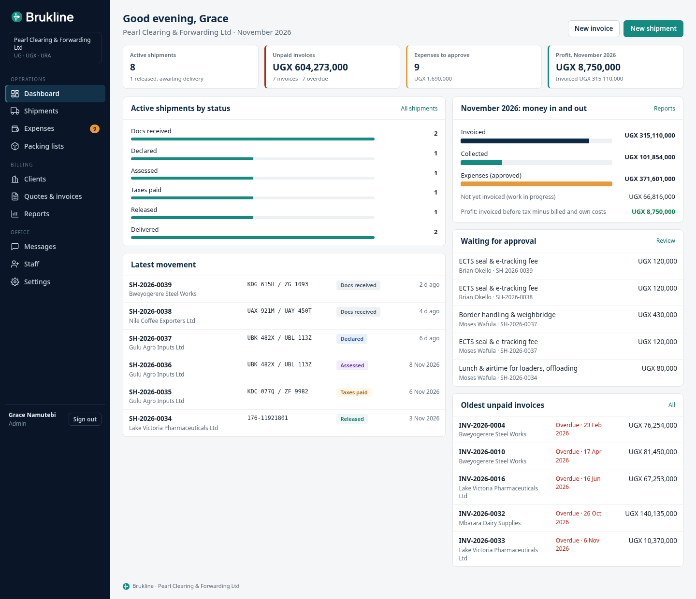

# Brukline

**Brukline** is office software for clearing and forwarding agents. It keeps clients, shipments and trucks, customs documents, quotations, invoices, receipts, packing lists, field staff expenses and client SMS/WhatsApp in one place. Each company sets its own country, currency, tax and customs authority, so the same install works in Uganda, Kenya, Tanzania, Rwanda, South Sudan or anywhere else.



## What it does

- **Shipments** move through the stages *Docs received → Declared → Assessed → Taxes paid → Released → Delivered → Closed*. Each one has a timeline of status changes and notes, its container and truck numbers, BL/AWB, entry number, station, route, and an assigned field agent.
- **Quotations, invoices and receipts** are branded PDFs with your logo, bank and mobile money details. They are numbered in sequence each year (`QT-2026-0001`, `INV-2026-0001`, `RC-2026-0001`). Lines are either **agency fees** or **disbursements** (duties and charges paid for the client), and each line can carry tax. A document can also show totals in a **second currency** (for example USD) at a fixed exchange rate. A quotation converts to an invoice in one click. Payments can be partial, and each one gives a receipt. Overpaying is blocked, and paid/partial/unpaid status is always worked out from the payments.
- **Packing lists** (`PL-2026-0001`) record shipper, consignee, client, container, BL/AWB, truck, invoice reference, origin and destination. Each item has marks, description, HS code, quantity, package type, number of packages, net and gross kg, and dimensions or CBM. Totals add up automatically, and the list prints as a PDF.
- **Field staff expenses.** Agents log what they spent on each truck from their phone (duties, port charges, transport, escort and so on) and can attach a photo or PDF of the receipt. An accountant or admin approves or rejects each one, with a reason. Approved disbursements are pulled into the client's invoice in one click, and none can be billed twice.
- **Profit per shipment:** what was invoiced (before tax) minus approved costs. Costs not yet invoiced are shown apart as *not yet invoiced* (work in progress).
- **Documents per shipment** (commercial invoice, BL, entry, assessment, release order and so on) can be uploaded and downloaded. Agents only see shipments assigned to them.
- **SMS and WhatsApp to clients.** Clients can get automatic status updates, and you can send invoices, receipts and one-off messages. Every message is logged with its delivery status.
- **Reports** cover a month, a year or any date range, and export as PDF or CSV (Excel). They show invoiced vs collected, receivables ageing, expenses by category and by staff member, profit per shipment and overall, shipments by status, station and client, top clients, and tax charged. The year view adds a month-by-month table and chart.
- **Staff.** Register staff with a role. Admins can reset passwords and deactivate staff; a deactivated user is signed out immediately.

### Roles

| Role | Can do |
|---|---|
| **Admin** | Everything, including company settings, logo and staff |
| **Accountant** | Clients, quotations, invoices, receipts, payments, approving expenses, reports, messages |
| **Field agent** | Only shipments assigned to them: status updates, notes, expenses with receipts, documents, packing lists. Agents never see invoices, client balances or company reports. |

## Any country

Each company has its own settings (**Settings → Country, money & tax**). Quick presets fill these in for UG, KE, TZ, RW, SS, ZA and NG.

| Setting | Example (Uganda) | Example (Kenya) |
|---|---|---|
| Country / phone code | UG / 256 | KE / 254 |
| Base currency (any ISO code) | UGX (0 decimals) | KES (2 decimals) |
| Second currency and rate | USD at 3,680 | USD at 129.40 |
| Tax name and default rate | VAT 18% | VAT 16% |
| Tax ID label | TIN | KRA PIN |
| Customs authority | URA | KRA |
| Locale / timezone | en-UG / Africa/Kampala | en-KE / Africa/Nairobi |
| Customs stations | Malaba, Busia, Mutukula, Elegu, Entebbe… | Mombasa Port, ICD Embakasi, JKIA… |

- Money is stored in whole minor units (shillings, cents). Decimal places come from the currency itself, so JPY and UGX use none and KES and USD use two.
- Local phone numbers such as `0772 123456` are saved in international form (`+256772123456`) using the company's phone code.
- Each document keeps the currency, tax rate and exchange rate it was issued with. Changing settings later does not alter old invoices.
- Document numbers and report months follow the company's own timezone.
- The customs stations list is yours to edit. Shipments offer it as suggestions, but you can still type any station.

## Run it on Windows (PowerShell)

You need **Node.js 22 or newer** (the current LTS from https://nodejs.org). Check with `node -v`. Docker is not needed, and it runs comfortably on a 4 GB laptop using the built-in SQLite file database.

```powershell
# 1. Unzip and install (one install for the API and the web app)
cd $HOME\Desktop
Expand-Archive .\brukline.zip -DestinationPath .   # creates a brukline folder
cd .\brukline
npm install

# 2. Create the API config file from the example
Copy-Item server\.env.example server\.env
notepad server\.env
```

In `server\.env`, set:

- **`DATABASE_URL`**, using one of these:
  - **Offline SQLite** (the default), which needs no account and no internet: `DATABASE_URL="file:./dev.db"`
  - **Neon Postgres**, free and online. Create a project at https://neon.tech and paste the pooled connection string.
- **`JWT_SECRET`**: a long random string. Generate one with:
  ```powershell
  node -e "console.log(require('crypto').randomBytes(48).toString('hex'))"
  ```

Then:

```powershell
# 3. Create the tables and load the demo companies
npm run setup          # = prisma db push + seed

# 4. Start the API (port 4100) and the web app (port 5273) together
npm run dev
```

Open http://localhost:5273 and sign in. All demo accounts use the password `Demo@2026`.

| Company | Role | Email |
|---|---|---|
| Pearl Clearing & Forwarding Ltd (Uganda, UGX) | Admin | `admin@pearlclearing.demo` |
| | Accountant | `accounts@pearlclearing.demo` |
| | Field agent (Brian) | `agent@pearlclearing.demo` |
| | Field agent (Moses) | `moses@pearlclearing.demo` |
| Bandari Clearing & Forwarding Ltd (Kenya, KES) | Admin | `admin@bandariclearing.demo` |
| | Field agent | `agent@bandariclearing.demo` |

Both demo companies are fictional, and all names and phone numbers are made up. Pearl has January–November 2026 history: about 47 shipments, quotations, invoices, 42 receipts, 200+ expenses with receipts, two packing lists, messages, and a deactivated staff member. That gives the reports something to show. Running `npm run seed -w server` again **wipes and recreates only the two demo companies**. Your own companies are left alone.

**Other commands**

```powershell
npm test                      # API and unit tests (uses a separate server\test.db)
npm run build                 # build the web app into client\dist
npm start                     # serve the API and the built web app on http://localhost:4100
npm run db:studio -w server   # browse the database in Prisma Studio
```

> If you switch `DATABASE_URL` between SQLite and Postgres, run `npm run generate -w server` (or `npm run setup`) again so Prisma regenerates its client.

> **npm 11 note:** if `npm install` warns about Prisma install scripts, run `npm install-scripts approve prisma @prisma/client @prisma/engines` and then `npm rebuild`.

## Sending real SMS / WhatsApp

By default both providers are `console`: messages are saved in the log and marked sent, but nothing leaves the computer and nothing costs money. To send for real, put the keys in `server\.env` and restart:

| Channel | Provider | Settings |
|---|---|---|
| SMS | Africa's Talking (UG, KE, TZ, RW, NG, MW, ZM…) | `SMS_PROVIDER=africastalking`, `AT_USERNAME`, `AT_API_KEY`, optional `AT_SENDER_ID`. The username `sandbox` tests for free. |
| WhatsApp | Twilio | `WHATSAPP_PROVIDER=twilio`, `TWILIO_ACCOUNT_SID`, `TWILIO_AUTH_TOKEN`, `TWILIO_WHATSAPP_FROM` |
| WhatsApp | Meta Cloud API | `WHATSAPP_PROVIDER=meta`, `META_WA_TOKEN`, `META_WA_PHONE_NUMBER_ID` |

Each client chooses SMS or WhatsApp. Invoice and quotation messages include a private "view your document" link built from `PUBLIC_URL`, so set that to your real web address once deployed.

## How the numbers are worked out

- **Invoiced** is the total of invoices issued in the period, including tax. Void invoices are left out.
- **Collected** is payments (receipts) dated in the period, whatever month the invoice was issued.
- **Expenses** are approved staff expenses spent in the period.
- **Not yet invoiced** (work in progress) is approved expenses marked *recharge to client* that are not yet on an invoice. They are money the client still owes you, so they are **not** counted as a cost until billed.
- **Profit** = invoiced before tax − (approved expenses − not yet invoiced).
- **Receivables ageing** groups unpaid balances at the end of the period by days past the due date: not yet due, 1–30, 31–60, 61–90, over 90.
- Months start at local midnight in the company's timezone, so a payment at 00:30 on 1 November in Kampala counts in November.

## Project layout

```
brukline/
├─ package.json            npm workspaces: server + client; setup / dev / build / test
├─ server/                 Node 22 · Express 5 · Prisma 6 · Zod · JWT · bcrypt · Helmet · pdfkit · multer
│  ├─ prisma/schema.prisma Company, User, Client, Shipment, ShipmentEvent, SalesDoc, LineItem, Payment,
│  │                       Expense, ShipmentFile, PackingList(+Item), Message, DocCounter
│  ├─ prisma/seed.js       demo companies (Uganda + Kenya)
│  ├─ assets/              Brukline logo used on PDFs
│  ├─ src/routes/          auth, company, staff, clients, shipments, expenses, files, docs,
│  │                       packing-lists, messages, dashboard, reports, public (shared document links)
│  ├─ src/lib/             money, phone, numbering, invoice, packing, period, reports, pdf, access, uploads
│  ├─ src/notifications/   SMS / WhatsApp providers and message text
│  ├─ uploads/             uploaded files (git-ignored), one folder per company
│  └─ tests/               node:test unit + API tests
├─ client/                 React 19 · Vite · TypeScript · plain CSS
│  ├─ public/brand/        Brukline logo files; favicons in public/
│  └─ src/pages/           Dashboard, Shipments, ShipmentDetail, Expenses, PackingLists, Clients,
│                          Billing, DocEditor, DocView, Reports, Messages, Staff, Settings, Login
└─ screenshots/
```

## Deploying (for example, on Render)

1. Create a free Neon database and copy its connection string.
2. Create a Render **Web Service** from your repo:
   - Build command: `npm install && npm run build && npm run db:push -w server`
   - Start command: `npm start`
3. Set the environment variables `DATABASE_URL`, `JWT_SECRET`, `NODE_ENV=production`, `PUBLIC_URL` and any messaging keys. Set `VITE_DEMO_HINT=true` at build time only if you want the demo logins shown on the sign-in page.
4. Uploaded files are stored on local disk (`UPLOAD_DIR`). On Render, attach a persistent disk and point `UPLOAD_DIR` at it, or the files are lost on each deploy.

## Security notes

- Passwords are hashed with bcrypt. Sign-ins expire after 12 hours, and in production the API refuses to start without a strong `JWT_SECRET`.
- Resetting a password or deactivating a user signs them out everywhere at once.
- Login is limited to 20 attempts per 15 minutes per IP. Shared document links are rate-limited and use long random tokens.
- Every input is validated with Zod, and every query is filtered by the user's company. Field agents are limited to their own shipments.
- Uploads are checked by both extension and file type (PDF, JPG, PNG, WebP, Word, Excel, CSV), limited in size (`MAX_UPLOAD_MB`), and stored under random names outside the web root. They are only served after a permission check.
- CSV exports are protected against formula injection when opened in Excel.
- API keys live only in `server/.env`, which is git-ignored. `.env.example` has no secrets.

## Limits and next steps

- No direct link yet to customs systems (URA ASYCUDA, KRA iCMS/Simba, TRA TANCIS). Entry and assessment numbers are typed in.
- Payments are recorded by hand. MTN MoMo / Airtel Money / M-PESA collection APIs are not connected.
- No email sending yet. Documents go out by SMS/WhatsApp link or as downloaded PDFs.
- Meta WhatsApp only allows free-form messages within 24 hours of the client's last message. Outside that window you need approved templates.
- Exchange rates are typed in per company, with no live rate feed.
- One office per company. There are no branches or per-branch reports yet.

---

Powered by **Brukline**.
